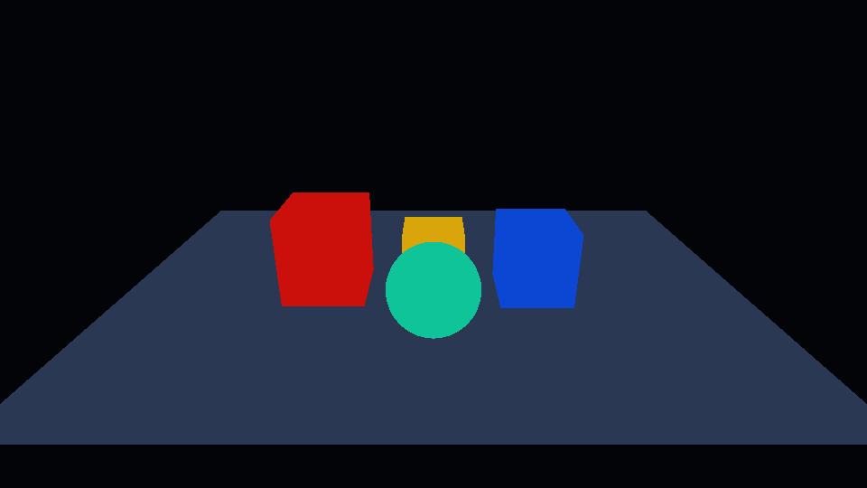
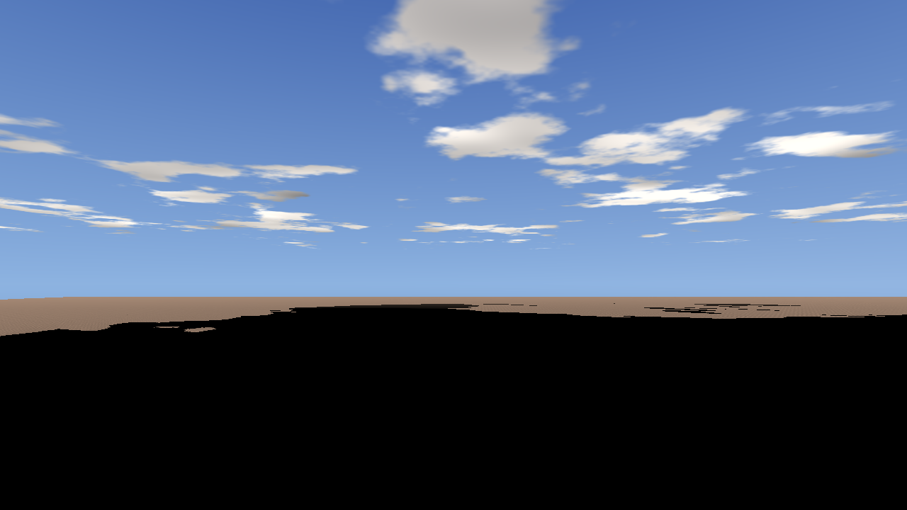
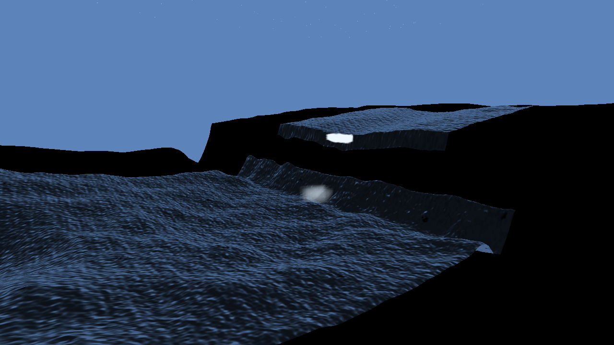

# Rendering upgrade status

Quantum uses forward PBR rendering with depth pre-pass, shadow atlases,
reflection probes, water, terrain, particles, and a user post-process chain.
The HDR path includes exposure, bloom, tone mapping, colour grading, and FXAA.

## Integrated passes

The current runtime has call sites for SSAO, SSR, depth of field, TAA, motion
blur, HDR, SSGI, screen-space contact shadows, decals, clustered/tiled forward
lighting, analytical atmosphere, and optional ray-marched fog/light shafts.
Materials also expose the advanced PBR terms used by the current glTF path,
including clearcoat, sheen, transmission, volume, and anisotropy data.

The render feature flags are useful for a real-frame smoke test:

```powershell
build\Release\quantum-engine.exe `
  --project templates/daynight --window 1280x720 `
  --render-feature taa --render-feature hdr `
  --render-feature atmosphere `
  --screenshot build\phase3.png --capture-frame 60
```

## Visual validation

`quantum-engine --screenshot` captures the presented frame, not a headless
placeholder. `--compare-screenshot` reports mean and maximum RGB error and
returns failure above the selected threshold. `scripts/phase3_visual.py` also
compiles shader variants across the available OpenGL, OpenGLES, D3D11, Metal,
and Vulkan toolchains. Use the static `tests/phase3/visual_fixture` for repeatable
temporal and shadow comparisons; the animated scale probe is not a visual
baseline. The harness includes the occluder/shadow mesh variants required by
the real scene, while decals remain covered by `tests/phase3/decal_fixture`.

The remaining visual qualification work is GPU/driver-specific baselines for
native backends and dedicated fixtures for decals, clustered light boundaries,
and cascade transitions. The `ssrfallback` fixture now covers the SSR probe
fallback path. A black region in a capture is a
backend/scene diagnostic, not something the documentation treats as finished
visual quality.

The reproducible OpenGL verification currently passes all nine static-fixture
cases: TAA, motion blur, HDR, LUT, clustered lighting, SSGI, SSR, atmosphere,
and cascaded shadows. Decals have a separate editor/runtime fixture. The run
uses the Release engine, a 320x180 presented-frame capture, the identity LUT
and a deterministic cinematic LUT generated by the harness; the cinematic
fixture also differs from the identity image, proving the grading transform is
active. All shader compilations returned zero. Keep these baselines as smoke
evidence, not as GPU-independent perceptual approval. For the probe fallback
specifically, run:

The Windows/MSVC workflow repeats the static-fixture capture twice in a
temporary directory, so shader compilation and frame determinism are checked
without launching the editor.

The Linux OpenGL backend now implements the same presented-frame readback as
Windows. The macOS Metal path retains the `CAMetalDrawable`, copies it through
the Sokol command queue into shared memory and converts the BGRA texture to the
RGBA bytes expected by the PNG writer. Vulkan adds transfer-source usage when
the surface supports it, copies the acquired swapchain image through a
host-visible staging buffer, restores the presentation layout and converts
BGRA/RGBA rows. The desktop workflow exercises Linux under Xvfb with software
Mesa; native Vulkan execution and GPU/driver baselines remain pending. Windows
D3D11 uses a CPU-readable staging texture and the same BGRA-to-RGBA conversion,
although the current local runtime gate still uses the default OpenGL
executable.

```powershell
python scripts/phase3_visual.py `
  --project tests/scale/probe `
  --engine build/Release/quantum-engine.exe `
  --resource-compiler build/Release/quantum-resource-compiler.exe `
  --feature ssrfallback --capture-frame 60
```

This fixture creates a small dynamic reflection probe in memory, captures its six
faces over the first frames, and then compares the presented SSR frame. It does
not modify the source scene.

## Current runtime captures

These images were captured from the presented frame of the current engine build.
They are useful smoke-test evidence while backend-specific reference baselines are
being assembled; they are not marketing renders.







